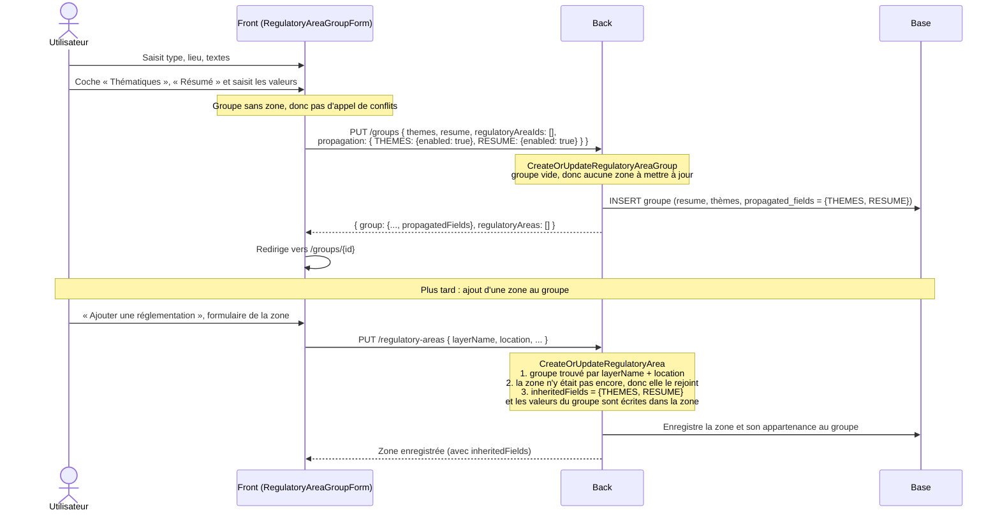
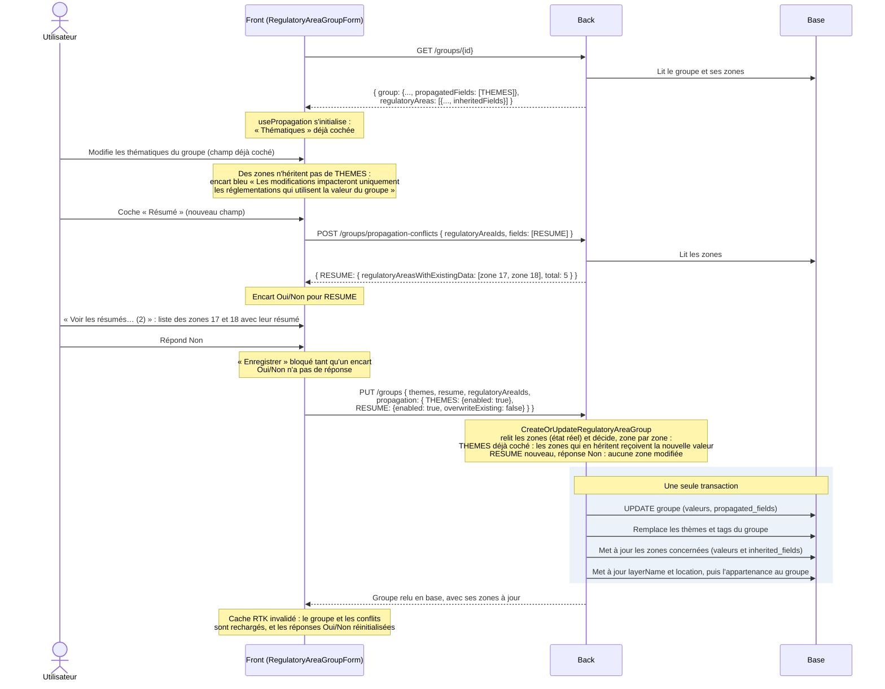

# Propager les données d'un groupe de zones réglementaires vers ses zones

Date : 19/11/2026

## Statut

En cours

## Contexte

Les groupes de zones réglementaires (ZR) et les ZR simples sont stockés dans la même table `regulatory_areas`, distingués par la colonne `area_type` (`GROUP` ou `ZONE`). Le lien entre un groupe et ses zones est porté par la table `regulatory_areas_group`.

On veut pouvoir saisir des données au niveau du groupe pour qu'elles s'appliquent aux zones du groupe :

- thématiques et sous-thématiques ;
- tags et sous-tags ;
- résumé ;
- période d'autorisation ;
- période d'interdiction.

Pour chacun de ces champs, une zone doit pouvoir soit **utiliser la valeur du groupe**, soit **garder sa propre valeur**, qui peut être vide. Le formulaire d'une zone doit savoir quels champs viennent du groupe. **C'est le choix fait sur la zone qui prend le dessus** : le groupe ne modifie jamais une zone qui a décoché un champ.

Les textes réglementaires (`refReg`, `type`, `url`, `date`, `dateFin`, `additionalRefReg`) sont déjà **hérités à la lecture** : la valeur du groupe remplace celle de la zone dans `RegulatoryAreaModel.toRegulatoryArea(mapper, group)`. Ils ne sont pas concernés par cet ADR.

## Options envisagées

1. **Copie simple** : la valeur du groupe est copiée dans les zones. Une fois copiée, elle ne se distingue plus d'une valeur propre à la zone. Chaque modification du groupe signale donc toutes les zones en conflit, et répondre « Non » laisse des copies périmées.
2. **Héritage à la lecture** : la zone ne stocke rien et la valeur du groupe est lue à la volée. Il faudrait adapter toutes les lectures en base : tuiles vectorielles, filtres par thématiques et tags, thématiques et tags des tableaux de bord, pipeline open data.
3. **Héritage logique, stockage dénormalisé (retenue)** : la zone indique quels champs elle hérite, et la valeur du groupe est aussi écrite dans les colonnes de la zone. Le back maintient cette copie à jour.

## Décision

### Héritage logique, stockage dénormalisé

- **Nouvelle colonne `regulatory_areas.inherited_fields text[]`** (migration `V0.239`), utilisée sur les zones : la liste des champs dont la zone utilise la valeur du groupe.
- **La valeur du groupe est aussi écrite dans la zone.** Toutes les lectures (tuiles, filtres, tableaux de bord, pipeline) restent donc inchangées.
- **Le back maintient la copie à jour** :
  - à la sauvegarde du groupe, les zones qui héritent d'un champ reçoivent sa nouvelle valeur ;
  - à la sauvegarde d'une zone, un champ hérité est toujours réécrit avec la valeur du groupe, quelle que soit la valeur envoyée.
- **Nouvelle colonne `regulatory_areas.propagated_fields text[]`** (migration `V0.239`), utilisée sur les groupes : la liste des champs que le groupe propose par défaut à ses zones.
- **Le groupe stocke ses propres valeurs** de thématiques, tags, résumé et périodes.

### Logique côté back

La logique est dans le domaine, côté back :

- `CreateOrUpdateRegulatoryAreaGroup` calcule le nouvel état de chaque zone. Le repository enregistre ensuite le groupe et les zones dans **une seule transaction**.
- `CreateOrUpdateRegulatoryArea` gère l'héritage d'une zone.
- Chaque champ sait dire si une zone a une valeur et comment hériter la valeur du groupe : `PropagatedFieldEnum` (`hasData`, `inherit`, `stopInheriting`).

Le back relit l'état réel des zones au moment de l'enregistrement, au lieu de faire confiance à ce que le front a affiché.

### Règles

**Sur la zone, par champ**

- **Case cochée** : la zone utilise la valeur du groupe.
- **Case décochée** : la zone utilise sa propre valeur, éventuellement vide. Le groupe ne la modifiera plus jamais.

**Sur le groupe**

| Action sur le groupe | Effet sur les zones | Affichage |
|---|---|---|
| Cocher un champ, aucune zone n'a de valeur propre | Toutes les zones héritent | Rien |
| Cocher un champ, des zones ont une valeur propre, réponse **Oui** | Toutes les zones héritent ; les valeurs propres sont remplacées | Encart Oui/Non avec la liste des zones et de leurs valeurs |
| Cocher un champ, des zones ont une valeur propre, réponse **Non** | Aucune zone n'est modifiée | Encart Oui/Non avec la liste des zones et de leurs valeurs |
| Modifier la valeur d'un champ déjà coché | Seules les zones qui héritent du champ reçoivent la nouvelle valeur | Si des zones n'héritent pas : encart bleu « Les modifications impacteront uniquement les réglementations qui utilisent la valeur du groupe » |
| Décocher un champ | Les zones qui en héritaient arrêtent d'hériter et **gardent la dernière valeur du groupe** comme valeur propre | Rien |

**Zone qui rejoint un groupe** : elle hérite de tous les champs cochés sur le groupe.

**Zone déjà dans le groupe** : le formulaire de la zone envoie ses `inheritedFields`. Ils sont limités aux champs propagés par le groupe. S'il n'envoie rien (`null`), la zone garde ses `inheritedFields` actuels.

Pour les thématiques et les tags, hériter veut dire **remplacer** la liste de la zone par celle du groupe, pas fusionner les deux.

### API

| Endpoint | Rôle |
|---|---|
| `GET /bff/v1/regulatory-areas/groups/{id}` | Renvoie le groupe (avec `propagatedFields`) et ses zones (avec `inheritedFields`) |
| `POST /bff/v1/regulatory-areas/groups/propagation-conflicts` | Pour chaque champ, liste les zones qui n'en héritent pas et qui ont une valeur propre |
| `PUT /bff/v1/regulatory-areas/groups` | Enregistre le groupe et met à jour ses zones |
| `PUT /bff/v1/regulatory-areas` | Enregistre une zone, avec un `inheritedFields` optionnel |

Corps de la requête de conflits :

```json
{ "regulatoryAreaIds": [17, 18, 19], "fields": ["THEMES", "RESUME"] }
```

Réponse (les zones sont renvoyées sans géométrie) :

```json
{
  "THEMES": {
    "regulatoryAreasWithExistingData": [
      { "id": 17, "polyName": "Zone au sud de la cale", "themes": [], "tags": [], "resume": "...", "inheritedFields": [] }
    ],
    "totalRegulatoryAreas": 3
  },
  "RESUME": { "regulatoryAreasWithExistingData": [], "totalRegulatoryAreas": 3 }
}
```

Options de propagation envoyées avec le groupe :

```json
{
  "propagation": {
    "THEMES": { "enabled": true, "overwriteExisting": true },
    "RESUME": { "enabled": true }
  }
}
```

- `enabled` : la case « associer par défaut » est cochée sur le groupe.
- `overwriteExisting` : la réponse à la question « écraser ? ». Elle n'est prise en compte que pour un champ qu'on vient de cocher, et elle est absente quand la question n'a pas été posée.

### Création d'un groupe

Un groupe en création n'a pas encore de zones : il n'y a ni conflit ni mise à jour de zone. On enregistre seulement la configuration, qui sert ensuite aux zones ajoutées au groupe.



### Modification d'un groupe



## Conséquences

- **Les lectures n'ont pas à connaître l'héritage**, puisque la valeur du groupe est écrite dans la zone.
- **Toute écriture qui modifie un champ propagable d'une zone doit passer par les use cases**, qui maintiennent la copie. Une écriture directe en base (par exemple depuis le pipeline) qui modifierait ces colonnes désynchroniserait une zone qui hérite. La resynchronisation se ferait alors à la prochaine sauvegarde du groupe ou de la zone.
- **Une zone peut avoir explicitement une valeur vide** : il suffit qu'elle n'hérite pas du champ.
- **Ajouter un nouveau champ propageable demande :**
  - une entrée dans `PropagatedFieldEnum` et dans `PropagatedValuesEntity` (back) ;
  - son écriture dans `JpaRegulatoryAreaGroupRepository.updateRegulatoryAreas` ;
  - l'ajout du champ dans `RegulatoryAreaGroupFields` et `PROPAGATED_FIELD_TO_FORM_KEY` (front) ;
  - son affichage dans `ConflictingRegulatoryAreas`.
- **Si le métier veut un jour fusionner** les thématiques ou les tags au lieu de les remplacer, il faudra remplacer le booléen `overwriteExisting` par un mode (par exemple `SKIP_EXISTING`, `OVERWRITE`, `MERGE`).
